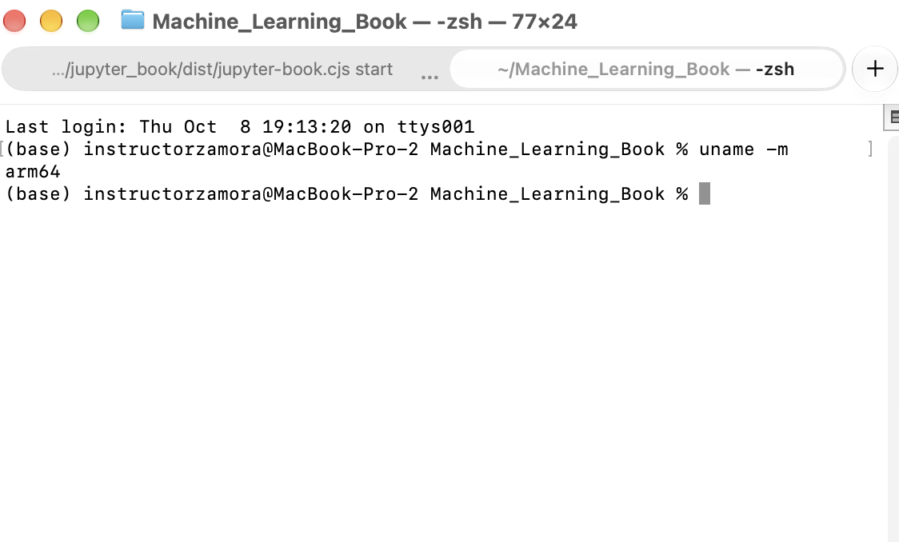
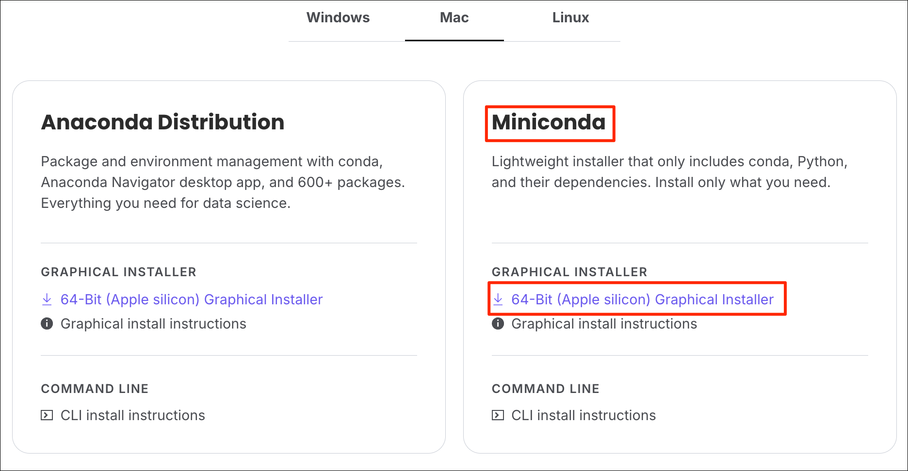
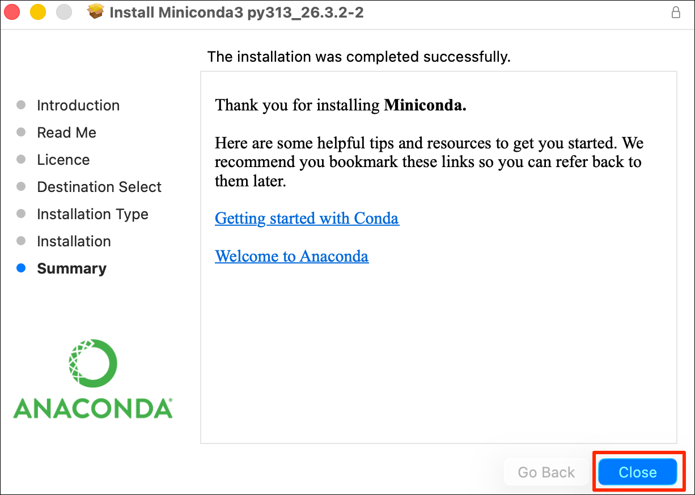
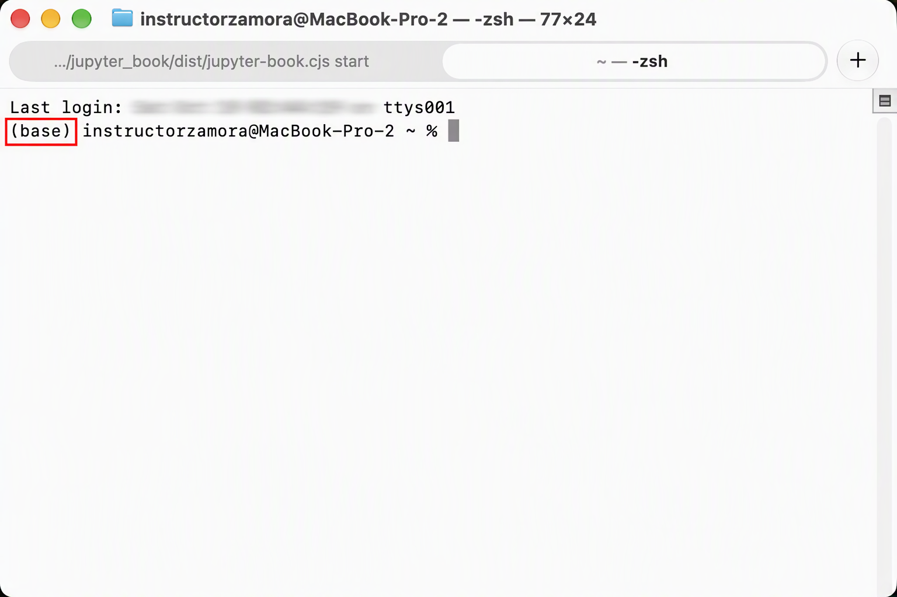
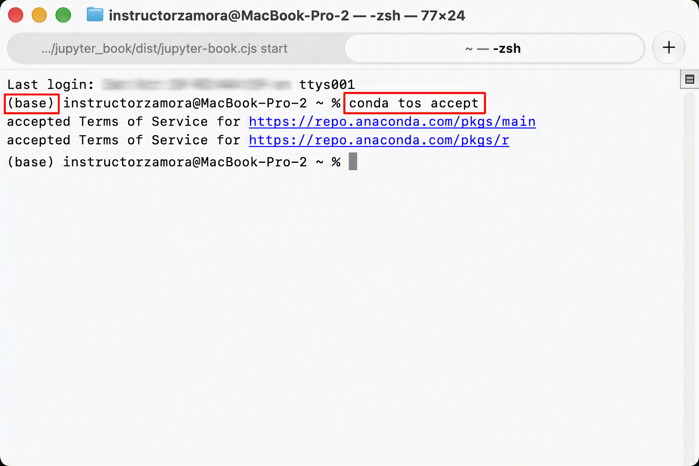

# Preparación del entorno de trabajo

## Introducción

Antes de comenzar a desarrollar modelos de *Machine Learning*, es necesario disponer de un entorno de trabajo correctamente configurado. En este capítulo se prepararán las herramientas que utilizaremos durante el curso, procurando que los procedimientos sean reproducibles tanto en **Windows**, **macOS** y **Linux**.

El entorno estará basado principalmente en **Python**, utilizando **Conda** para la gestión de entornos y dependencias, **Visual Studio Code** como editor de desarrollo y **Jupyter** para la ejecución interactiva de código y análisis de datos.

## Objetivos

```{admonition} Objetivos de aprendizaje
:class: important
Al finalizar este capítulo, el estudiante estará en capacidad de:

- Instalar y verificar las herramientas necesarias para trabajar con Python.
- Configurar Visual Studio Code para trabajar con Python y Jupyter.
- Crear y administrar un entorno virtual con Conda.
- Instalar las principales bibliotecas utilizadas en Machine Learning.
- Verificar que el entorno de trabajo funciona correctamente.
- Preparar una estructura de trabajo reproducible para los ejercicios y proyectos del curso.
```

## 0.1. Ecosistema tecnológico de trabajo

El desarrollo de proyectos de *Machine Learning* requiere un entorno computacional que permita integrar programación (`Scripting`), gestión de dependencias, experimentación, documentación y control de versiones. En este libro se utilizará un ecosistema de herramientas de código abierto y de uso ampliamente extendido en ciencia de datos, con el propósito de garantizar que los procedimientos desarrollados sean **reproducibles, organizados y transferibles** entre diferentes equipos y sistemas operativos.

###  Python

#### Introducción a Python

Todo empezó a finales de diciembre de 1989. Guido van Rossum, un programador holandés que trabajaba en el CWI (Centrum Wiskunde & Informatica, un centro de investigación en Ámsterdam), se encontró con unos días libres durante las fiestas y decidió buscar un proyecto de "hobby" para entretenerse [@severance2015guido]. Lo que quería era crear algo que fuera fácil de leer, que manejara errores de forma elegante y que pudiera comunicarse con el sistema operativo Amoeba, en el que estaba trabajando por aquel entonces [@swaroop2017byte]. Se inspiró en ABC, un lenguaje anterior que conocía bien, pero que tenía sus limitaciones. Así que se puso a escribir código y, sin saberlo, estaba poniendo la primera piedra de algo enorme.

El nombre, por cierto, no tiene nada que ver con el animal. Van Rossum era fanático de los Monty Python, el grupo de comedia británico, y quiso rendirles un homenaje con un nombre corto, un poco irreverente y fácil de recordar [@cwi2015python25]. La primera versión pública, la 0.9.0, vio la luz el 20 de febrero de 1991 a través de un grupo de noticias llamado alt.sources. Ya desde esa versión temprana estaban presentes cosas que hoy nos resultan familiares: clases, herencia, manejo de excepciones, funciones y los tipos de datos básicos como listas y diccionarios. No era un juguete; era una herramienta funcional desde el principio.

La comunidad empezó a formarse rápido. En 1994 se creó comp.lang.python, el foro de discusión que se convirtió en el punto de encuentro de los primeros usuarios. Ese mismo año llegó la versión 1.0, que añadió herramientas de programación funcional como lambda, map, filter y reduce. Guido seguía al mando, pero el desarrollo se volvía cada vez más colaborativo.

#### Por qué todo el mundo lo usa

En la actualidad prácticamente todos lo usan. Google, Meta, Amazon, Netflix, NASA, Pixar, JP Morgan Chase... la lista es interminable. Pero no se trata solo de gigantes tecnológicos. Marketers que automatizan la recolección de datos de la competencia, periodistas que hacen periodismo de datos, especialistas de recursos humanos que analizan métricas de personal, ingenieros de control de calidad que automatizan pruebas... todos han encontrado en Python una herramienta accesible para resolver problemas concretos.

Un estudio publicado en 2025 en la revista IEEE *Transactions on Parallel and Distributed Systems* lo resume sin rodeos: "Python se ha convertido en el lenguaje de facto para la computación científica" [@ziogas2025datacentric]. Y no es una exageración. Ese mismo paper señala que la demanda de soporte de Python en computación de alto rendimiento (HPC) se ha disparado, precisamente porque su ecosistema científico, construido alrededor de `NumPy`, es enormemente productivo. Campos que van desde el *Machine Learning* hasta la *climatología* y el *transporte cuántico* ya han adoptado Python como su lenguaje de elección para nuevos desarrollos.

#### El presente: Python como lengua franca de la IA

Si hay un campo donde Python se ha vuelto absolutamente dominante, ese es la inteligencia artificial. El propio *Guido van Rossum* lo explicó con una idea sencilla: la gente que hoy escribe código para IA empezó en el aprendizaje automático (*Machine Learning*), y en ese mundo Python ya era el estándar[@venegas2026pythonia]. Cuando una tecnología alcanza una masa crítica de usuarios y bibliotecas, se vuelve cada vez más atractiva para nuevos proyectos, y eso refuerza su posición [@venegas2026pythonia]. Es un círculo virtuoso.

Hoy, más del 80% de los profesionales de **machine learning** usan Python, respaldados por herramientas como `TensorFlow`, `PyTorch`, `scikit-learn` y todo el ecosistema de `Hugging Face`. El 71% de las ofertas de empleo para ingenieros de IA exigen conocimientos de Python. No es que sea el único lenguaje que sirve para IA, pero sí es el que tiene las bibliotecas más maduras, la documentación más completa y la comunidad más grande. Y eso, para quien empieza, marca una diferencia enorme.

Pero Python no vive solo de la IA. En **ciencia de datos**, bibliotecas como `Pandas`, `NumPy` y `Matplotlib` son el pan de cada día para convertir datos crudos en información útil. En desarrollo `web`, `Django` y `FastAPI` compiten cara a cara con frameworks de otros lenguajes. En automatización, es el rey indiscutible: `scripts` para renombrar archivos, enviar correos, extraer datos de webs, lo que se te ocurra. Y en educación, es el lenguaje con el que muchísimas universidades enseñan a programar por primera vez.

```{admonition} En resumen
:class: important
**[Python](https://www.python.org/)** será el lenguaje de programación principal. Su sintaxis relativamente accesible y, especialmente, su amplio ecosistema de bibliotecas científicas permiten abordar de manera integrada tareas de manipulación de datos, análisis estadístico, visualización y construcción de modelos de *Machine Learning*.
```

A lo largo del libro se incorporarán progresivamente bibliotecas según áreas de aplicación como:

1. **Librería para el desarrollo web:**

- **Django:** Framework web completo para crear aplicaciones robustas y escalables. Consultar [djangoproject.com](https://www.djangoproject.com/)
  - **Uso principal:** Aplicaciones empresariales, portales web y e-commerce.

- **Flask:** Microframework ligero y flexible que permite desarrollar aplicaciones web y APIs con pocas dependencias. Consultar [flask.palletsprojects.com](https://flask.palletsprojects.com/en/stable/)
  - **Uso principal:** APIs REST, microservicios y prototipos rápidos.

- **FastAPI:** Framework moderno para construir APIs de alto rendimiento utilizando tipado de Python. Consultar [fastapi.tiangolo.com](https://fastapi.tiangolo.com/)
  - **Uso principal:** APIs REST, microservicios e integración de modelos de IA.

- **Pyramid:** Framework flexible que se adapta tanto a proyectos pequeños como a aplicaciones empresariales. Consultar [trypyramid.com](https://trypyramid.com/)
  - **Uso principal:** Aplicaciones web escalables y arquitecturas personalizadas.

- **Bottle:** Microframework minimalista distribuido en un único archivo Python. Consultar [bottlepy.org](https://bottlepy.org/docs/dev/)
  - **Uso principal:** Aplicaciones sencillas, APIs pequeñas y aprendizaje.

- **Tornado:** Framework asíncrono diseñado para gestionar gran cantidad de conexiones simultáneas. Consultar [tornadoweb.org](https://www.tornadoweb.org/en/stable/)
  - **Uso principal:** Aplicaciones en tiempo real, WebSockets y sistemas de notificaciones.

- **Litestar:** Framework ASGI moderno para desarrollar APIs y servicios web de alto rendimiento. Consultar [litestar.dev](https://litestar.dev/)
  - **Uso principal:** APIs REST, microservicios y aplicaciones en la nube.

| **Resumen rápido** |  |  |
|---|---|---|
| **Framework** | **Tipo** | **Uso principal** |
| Django | Framework completo | Aplicaciones web grandes |
| Flask | Microframework | Aplicaciones y APIs ligeras |
| FastAPI | Framework API | APIs modernas y Machine Learning |
| Pyramid | Framework flexible | Aplicaciones empresariales |
| Bottle | Microframework | Proyectos pequeños y educativos |
| Tornado | Framework asíncrono | Aplicaciones en tiempo real |
| Litestar | Framework ASGI | APIs y microservicios modernos |

2. **Librerías de procesamiento de datos en python**

- **Pandas:** Biblioteca especializada en la manipulación y análisis de datos mediante estructuras como Series y DataFrames. Consultar [pandas.pydata.org](https://pandas.pydata.org/)
  - **Uso principal:** Limpieza, transformación y análisis de datos tabulares.

- **NumPy:** Biblioteca fundamental para la computación numérica en Python que proporciona arreglos multidimensionales y funciones matemáticas de alto rendimiento. Consultar [numpy.org](https://numpy.org/)
  - **Uso principal:** Operaciones matemáticas, álgebra lineal y manejo eficiente de arreglos.

- **SciPy:** Biblioteca construida sobre NumPy que incorpora herramientas avanzadas para computación científica y técnica. Consultar [scipy.org](https://scipy.org/)
  - **Uso principal:** Optimización, estadística, procesamiento de señales e integración numérica.

- **IPython:** Entorno interactivo avanzado para Python que facilita la exploración, ejecución y depuración de código. Consultar [ipython.org](https://ipython.org/)
  - **Uso principal:** Computación interactiva, análisis de datos y desarrollo científico.

| **Resumen rápido** |  |  |
|---|---|---|
| **Librería** | **Tipo** | **Uso principal** |
| Pandas | Análisis de datos | Manipulación y análisis de datos tabulares |
| NumPy | Computación numérica | Operaciones matemáticas y arreglos multidimensionales |
| SciPy | Computación científica | Estadística, optimización y cálculo científico |
| IPython | Entorno interactivo | Desarrollo, análisis y computación interactiva |

3. **Librerías de visualización de datos**

- **Matplotlib:** Biblioteca fundamental para la creación de gráficos estáticos, animados e interactivos en Python. Consultar [matplotlib.org](https://matplotlib.org/)
  - **Uso principal:** Generación de gráficos de líneas, barras, histogramas y diagramas científicos.

- **Seaborn:** Biblioteca de visualización construida sobre Matplotlib que facilita la creación de gráficos estadísticos atractivos. Consultar [seaborn.pydata.org](https://seaborn.pydata.org/)
  - **Uso principal:** Análisis exploratorio de datos y visualizaciones estadísticas.

- **Plotly:** Biblioteca para crear gráficos interactivos y dashboards dinámicos que pueden visualizarse en navegadores web. Consultar [ploty.com](https://plotly.com/python/) 
  - **Uso principal:** Visualizaciones interactivas, dashboards y análisis de datos en tiempo real.

| **Resumen rápido** |  |  |
|---|---|---|
| **Librería** | **Tipo** | **Uso principal** |
| Matplotlib | Visualización básica | Gráficos científicos y estadísticos |
| Seaborn | Visualización estadística | Análisis exploratorio y gráficos avanzados |
| Plotly | Visualización interactiva | Dashboards y gráficos interactivos |

4. **Librería de inteligencia artificial y machine learning**

- **PyTorch:** Framework de aprendizaje profundo desarrollado por Meta que permite construir y entrenar redes neuronales de forma flexible. Consultar [pytorch.org](https://pytorch.org/)
  - **Uso principal:** Deep Learning, visión por computador y procesamiento de lenguaje natural.

- **TensorFlow:** Framework de código abierto desarrollado por Google para construir modelos de Inteligencia Artificial y Machine Learning a gran escala. Consultar [tensoflow](https://www.tensorflow.org/?hl=es-419)
  - **Uso principal:** Redes neuronales, Deep Learning y despliegue de modelos en producción.

- **Keras:** Biblioteca de alto nivel para construir redes neuronales de forma sencilla. Actualmente se integra estrechamente con TensorFlow. Consultar [keras.oi](https://keras.io/)
  - **Uso principal:** Desarrollo rápido y entrenamiento de modelos de Deep Learning.

- **Scikit-Learn:** Biblioteca de Machine Learning que proporciona algoritmos para clasificación, regresión, agrupamiento y reducción de dimensionalidad. Consultar [scikit-learn.org](https://scikit-learn.org/stable/)
  - **Uso principal:** Modelado predictivo y análisis de datos.

- **Transformers:** Biblioteca desarrollada por Hugging Face que facilita el uso de modelos avanzados de procesamiento de lenguaje natural e IA generativa. Consultar [huggingface.co](https://huggingface.co/docs/transformers/index)
  - **Uso principal:** Chatbots, traducción automática, clasificación de texto y modelos de lenguaje.

- **Anthropic:** Plataforma de Inteligencia Artificial conocida por la familia de modelos Claude, diseñada para desarrollar aplicaciones seguras basadas en IA generativa. Consultar [anthropic.com](https://platform.claude.com/docs/es/home)
  - **Uso principal:** Asistentes conversacionales, automatización y generación de contenido.

- **LangChain:** Framework para desarrollar aplicaciones basadas en modelos de lenguaje (LLM), facilitando la integración con documentos, bases de datos y herramientas externas. Consultar [langchain](https://www.langchain.com/)
  - **Uso principal:** Sistemas RAG, agentes inteligentes y aplicaciones con IA generativa.

- **SHAP:** Biblioteca para interpretar modelos de Machine Learning mediante valores SHAP (SHapley Additive exPlanations). Consultar [shap.readthedocs.io](https://shap.readthedocs.io/)
  - **Uso principal:** Explicabilidad e interpretación de modelos de IA.

| **Resumen rápido** |  |  |
|---|---|---|
| **Librería** | **Tipo** | **Uso principal** |
| PyTorch | Deep Learning | Redes neuronales y visión por computador |
| TensorFlow | Deep Learning | Entrenamiento y despliegue de modelos de IA |
| Scikit-Learn | Machine Learning | Clasificación, regresión y análisis predictivo |
| Transformers | IA Generativa | Procesamiento de lenguaje natural y LLM |
| Anthropic | IA Generativa | Asistentes inteligentes y automatización |
| LangChain | Framework LLM | Agentes inteligentes y sistemas RAG |

5. **Librerías para modelos de Gradient Boosting**

- **XGBoost:** Biblioteca optimizada para implementar algoritmos de Gradient Boosting con alto rendimiento y escalabilidad. Consultar [xgboost](https://xgboost.readthedocs.io/en/stable/)
  - **Uso principal:** Clasificación, regresión y competiciones de ciencia de datos.

- **LightGBM:** Framework desarrollado por Microsoft para entrenar modelos de Gradient Boosting de manera rápida y eficiente sobre grandes volúmenes de datos. Consultar [lightgbm](https://lightgbm.readthedocs.io/en/latest/index.html)
  - **Uso principal:** Predicción y análisis de datos a gran escala.

- **CatBoost:** Biblioteca desarrollada por Yandex especializada en el manejo eficiente de variables categóricas. Consultar [catboost.ai](https://catboost.ai/docs/en/)
  - **Uso principal:** Clasificación y regresión con datos tabulares.

| **Resumen rápido** |  |  |
|---|---|---|
| **Librería** | **Tipo** | **Uso principal** |
| XGBoost | Gradient Boosting | Modelos predictivos de alto rendimiento |
| LightGBM | Gradient Boosting | Predicción sobre grandes conjuntos de datos |
| CatBoost | Gradient Boosting | Modelos con variables categóricas |

Las bibliotecas especializadas se instalarán progresivamente a medida que sean requeridas, evitando incorporar dependencias innecesarias desde el inicio.

### Anaconda

Anaconda es una distribución de **software libre y de código abierto** de los lenguajes Python y R, ampliamente utilizada en *ciencia de datos,* *aprendizaje automático* (Machine Learning), procesamiento de grandes volúmenes de información, análisis predictivo y cómputos científicos. Fue lanzada el 6 de septiembre de 2012 y es desarrollada por Anaconda, Inc.

En el núcleo de Anaconda se encuentra conda, un gestor de paquetes y entornos de código abierto que se encarga de instalar software, resolver dependencias y mantener los proyectos aislados entre sí, de modo que actualizar un proyecto nunca rompa otro [@anaconda_docs]. Conda es multiplataforma (Windows, macOS y Linux), admite múltiples lenguajes (Python, R, C/C++, Ruby, etc.) y no requiere privilegios de administrador para instalar software o crear entornos.

La Anaconda Distribution (la versión completa) instala conda, Python, Anaconda Navigator (una interfaz gráfica de escritorio) y **cientos de paquetes populares de ciencia de datos y machine learning** en un entorno base preconstruido. Está diseñada para usuarios que desean un entorno completo y listo para usar desde el primer día. Según la documentación oficial de Anaconda, la distribución completa incluye **más de 600 paquetes** y requiere aproximadamente 9.7 GB de espacio en disco. Otras fuentes cifran el espacio necesario en **~4.4 GB** o **~3 GB** como mínimo para la descarga e instalación.

#### Miniconda y Conda

Se utilizará **Miniconda** como distribución ligera y **Conda** como gestor de entornos y paquetes. Su función principal será mantener aisladas las dependencias utilizadas en el libro.

Un entorno independiente permite especificar versiones concretas de Python y de sus bibliotecas, reduciendo conflictos entre proyectos y favoreciendo la **reproducibilidad computacional**.

En este libro trabajaremos dentro de un entorno específico para Machine Learning, de manera que las instalaciones realizadas durante el curso no alteren otros proyectos existentes en el equipo.

### Visual Studio Code

**Visual Studio Code (VS Code)** será el entorno principal de desarrollo del proyecto. Se trata de un editor de código fuente multiplataforma, de código abierto y extensible, que ocupa una posición intermedia entre un editor de texto tradicional y un Entorno de Desarrollo Integrado (*IDE*): combina la ligereza del primero con funcionalidades propias del segundo, como el análisis estático, la depuración y la integración con sistemas de control de versiones.

Desde esta herramienta será posible trabajar con los principales tipos de archivo del proyecto:

- Scripts de Python (`.py`).
- Documentos Markdown (`.md`).
- Notebooks de Jupyter (`.ipynb`).
- Archivos de configuración (por ejemplo, `.json`, `.yaml` o `.env`).

Mediante sus extensiones para Python y Jupyter, VS Code permitirá integrar en una misma interfaz la escritura de código, ejecución de notebooks, administración de archivos, terminal, control de versiones y documentación.

### Jupyter

**[Jupyter](https://jupyter.org/)** proporcionará el entorno interactivo del curso, destinado a la experimentación con código y al desarrollo de análisis reproducibles. Se trata de un ecosistema de código abierto, independiente del lenguaje de programación, cuyo componente central es el *notebook*: un documento computacional que combina, en un mismo archivo (`.ipynb`), instrucciones ejecutables y su documentación. Aunque admite múltiples lenguajes mediante *kernels*, en este curso se utilizará con Python.

#### Estructura de un notebook

Un notebook se organiza en celdas independientes que pueden ejecutarse de forma secuencial o selectiva. Cada celda puede contener:

- código ejecutable;
- resultados numéricos;
- tablas;
- visualizaciones;
- ecuaciones matemáticas (mediante notación LaTeX);
- explicaciones metodológicas (mediante Markdown).

Esta integración permite documentar de manera simultánea el procedimiento analítico, los resultados obtenidos y su interpretación, evitando la dispersión de la información en archivos separados.

#### Ventajas en el contexto del curso

- **Reproducibilidad:** el flujo completo del análisis, desde la carga de datos hasta la evaluación de un modelo, queda registrado y puede volver a ejecutarse.
- **Interactividad:** la ejecución por celdas facilita probar hipótesis, ajustar hiperparámetros y observar el efecto inmediato de cada cambio.
- **Valor didáctico:** el formato resulta especialmente apropiado para la enseñanza de estadística, ciencia de datos y *Machine Learning*, ya que expone el razonamiento junto con el código que lo implementa.
- **Comunicación de resultados:** los notebooks pueden exportarse a formatos como HTML o PDF, lo que facilita compartir los análisis con personas que no necesariamente trabajan con código.

#### Integración con VS Code

Los notebooks de Jupyter pueden abrirse, editarse y ejecutarse directamente desde VS Code mediante su extensión oficial, de modo que ambas herramientas se complementan: VS Code aporta la edición asistida, la depuración y el control de versiones, mientras que Jupyter aporta la interactividad y la documentación del análisis.

### Jupyter Book 2

**Jupyter Book 2**, basado en el ecosistema **MyST**, será la herramienta utilizada para construir y organizar el curso como un libro. Se trata de un proyecto de código abierto, vinculado a la comunidad de Project Jupyter, que permite crear documentos técnicos y científicos a partir de archivos de texto y notebooks ejecutables, y publicarlos posteriormente en formato web.

#### MyST

**¿Qué es?** **MyST** (*Markedly Structured Text*) es un ecosistema de código abierto para la escritura científica y técnica. Comprende tanto una sintaxis, **MyST Markdown**, como un conjunto de herramientas que procesan esa sintaxis para producir documentos estructurados, como sitios web, artículos o libros. Fue desarrollado en el marco del proyecto *Executable Books*, dentro de la comunidad de Project Jupyter.

**¿Por qué utilizarlo?**

- **Texto plano y ligereza:** los archivos `.md` no incluyen metadatos ni estructuras de formato adicionales, por lo que son livianos, fáciles de leer y de editar con cualquier herramienta. Una ventaja secundaria es que también resultan más eficientes para asistentes de IA (menor consumo de *tokens*) que formatos como `.ipynb`, HTML o PDF.
- **Escritura científica:** permite incorporar ecuaciones, citas, figuras y referencias cruzadas sin abandonar una sintaxis sencilla y legible.
- **Integración con contenido ejecutable:** combina texto y notebooks, de modo que el código, sus resultados y su explicación forman parte del mismo documento.
- **Publicación en múltiples formatos:** a partir de una misma fuente pueden generarse sitios web y documentos en otros formatos, como PDF.
- **Compatibilidad con el control de versiones:** al basarse en archivos de texto, se integra de manera natural con Git, y los cambios entre versiones son fáciles de leer.

**¿Dónde se utiliza?**

- En **libros y materiales didácticos** interactivos, como los construidos con Jupyter Book.
- En **documentación técnica** de proyectos de software, en particular dentro del ecosistema de Python y Sphinx.
- En **artículos científicos y preprints** con contenido reproducible.
- En **cursos y entornos académicos** donde se requiere unir teoría, código y resultados.

#### MyST Markdown

Es la sintaxis de escritura de este ecosistema: una extensión de Markdown que conserva su simplicidad, pero incorpora elementos propios de la documentación estructurada, como directivas, roles y referencias cruzadas. Esto permite construir documentos con una organización formal sin renunciar a la legibilidad del texto plano.

Consulta la guía de Markdown: [Guía Markdown](https://msc-zamora-thowinsson.github.io/.md-guia/#/inicio)

#### Jupyter Book 2 en este curso

Jupyter Book 2 permite combinar, dentro de una misma estructura editorial:

- capítulos escritos en Markdown;
- notebooks ejecutables (`.ipynb`);
- expresiones matemáticas (mediante notación LaTeX);
- referencias bibliográficas y citas;
- figuras y tablas numeradas, con referencias cruzadas;
- otros recursos científicos, como teoremas y demostraciones.

Sus principales ventajas para el curso son:

- **Organización:** los capítulos y secciones se estructuran mediante archivos de configuración, lo que facilita mantener un libro extenso.
- **Reproducibilidad:** el contenido computacional (código, resultados y gráficos) puede regenerarse a partir de las fuentes.
- **Publicación:** el curso puede difundirse como sitio web y exportarse a otros formatos.
- **Control de versiones:** el trabajo colaborativo y el seguimiento de cambios se gestionan con Git.

#### Distribución de funciones entre las herramientas

La separación entre las herramientas es importante: **VS Code será el entorno de desarrollo, Jupyter facilitará la experimentación computacional y Jupyter Book/MyST proporcionará la estructura editorial del curso**. Así, cada herramienta cumple una función específica y complementaria, desde la escritura y el análisis hasta la publicación final.

### Git y GitHub

#### Git   

**¿Qué es?** - **[Git](https://git-scm.com/)** es un sistema de control de versiones distribuido, de código abierto, creado por Linus Torvalds en 2005. Registra los cambios realizados sobre un conjunto de archivos a lo largo del tiempo, de modo que es posible consultar versiones anteriores, comparar modificaciones y recuperar el estado del proyecto en cualquier momento. Al ser distribuido, cada persona dispone de una copia completa del historial en su propio equipo, lo que permite trabajar sin conexión.

**¿Por qué utilizarlo?**

- **Historial completo:** cada cambio queda registrado en un *commit* con su autor, fecha y descripción, lo que permite auditar la evolución del proyecto.
- **Reversibilidad:** si una modificación introduce un error, se puede volver a una versión anterior sin pérdida de información.
- **Experimentación segura:** las *ramas* (*branches*) permiten probar cambios de forma aislada y fusionarlos (*merge*) con la versión principal solo cuando están validados.
- **Trabajo colaborativo:** varias personas pueden modificar el mismo proyecto de manera simultánea y combinar sus aportes.
- **Eficiencia con texto plano:** Git funciona especialmente bien con archivos `.md`  y `.py`, porque muestra con claridad qué líneas cambiaron entre versiones.

**¿Dónde se utiliza?**

- En el **desarrollo de software**, donde es el estándar de la industria.
- En **ciencia de datos y Machine Learning**, para versionar código, experimentos y configuraciones.
- En **documentación técnica y libros** escritos en texto plano, como los construidos con Jupyter Book.
- En **entornos académicos**, para gestionar trabajos, tesis y materiales de curso.

#### GitHub

**¿Qué es?** - **[GitHub](https://github.com/)** es una plataforma en línea para alojar repositorios Git y colaborar sobre ellos. Fue lanzada en 2008 y pertenece a Microsoft desde 2018. Es importante distinguirla de Git: Git es la herramienta que gestiona las versiones, mientras que GitHub es el servicio que almacena esos repositorios en la nube y añade herramientas de colaboración.

**¿Por qué utilizarlo?**

- **Copia de seguridad en la nube:** el proyecto queda respaldado fuera del equipo local y accesible desde cualquier lugar.
- **Colaboración estructurada:** mediante *issues* (tareas y reportes), *pull requests* (propuestas de cambio revisables) y comentarios.
- **Publicación gratuita:** con **GitHub Pages** es posible publicar un libro o sitio web estático directamente desde el repositorio, que es la vía natural para difundir un libro construido con Jupyter Book.
- **Automatización:** **GitHub Actions** permite ejecutar procesos automáticos, como construir el libro y desplegarlo cada vez que se actualiza el contenido.
- **Difusión y comunidad:** facilita compartir material con licencia abierta, recibir sugerencias y que otras personas reutilicen el curso.

**¿Dónde se utiliza?**

- En **proyectos de código abierto** de todo tipo.
- En **equipos de desarrollo** profesionales, como plataforma de revisión y colaboración.
- En **educación**, para distribuir materiales, ejercicios y entregas.
- En **portafolios profesionales**, donde se exhiben proyectos y análisis.

#### Git y GitHub en este curso

En este curso, Git y GitHub cumplirán tres funciones:

- **Control de versiones** de los capítulos, notebooks y archivos de configuración.
- **Respaldo y trabajo colaborativo** sobre el material del curso.
- **Publicación** del libro como sitio web mediante GitHub Pages.

Una consideración práctica: los notebooks `.ipynb` almacenan resultados e imágenes dentro del archivo, por lo que sus cambios son más difíciles de leer en el historial de Git que los de un `.md`. Por ello se recomienda versionar preferentemente los archivos en texto plano y limpiar las salidas de los notebooks antes de cada *commit*.

#### Integración con VS Code

VS Code incluye soporte nativo para Git: desde su interfaz es posible ver los archivos modificados, comparar cambios, crear *commits*, gestionar ramas y sincronizar el repositorio con GitHub, sin necesidad de usar la línea de comandos para las operaciones básicas.

## 0.2. Arquitectura general del entorno

El flujo tecnológico utilizado a lo largo del libro puede resumirse de la siguiente manera:

**Python → Conda → VS Code/Jupyter → Jupyter Book + MyST → Git → GitHub**

Cada componente cumple una función diferente dentro del proceso. Esta separación permite construir un entorno de trabajo modular en el que el análisis, la documentación, la gestión de dependencias y el control de versiones puedan mantenerse de forma organizada y reproducible.

En las siguientes secciones se realizará la instalación y configuración del entorno de manera diferenciada para **Windows** y **macOS**, verificando cada componente antes de comenzar con el desarrollo de los modelos de Machine Learning.

## 0.3. Instalación y configuración de entornos

La preparación adecuada del entorno computacional constituye un requisito fundamental para desarrollar proyectos reproducibles de *Machine Learning*. En macOS se utilizará **Miniconda** para administrar Python y sus dependencias mediante entornos virtuales independientes. Esta estrategia reduce los conflictos entre proyectos y evita modificar innecesariamente la configuración de Python del sistema.

### 0.3.1. ¿Qué es un entorno?

En Machine Learning, el término "entorno" (o environment) suele referirse a dos conceptos muy distintos dependiendo del contexto en el que te encuentres:

1. **Entorno de Desarrollo y Ejecución (*Software Environment*)**

Este es el uso más común en el trabajo diario de modelado predictivo, estadística aplicada y despliegue de aplicaciones. Se refiere al ecosistema aislado de software que configuras para construir, entrenar o desplegar un modelo.

- **¿Qué lo compone?** La versión exacta del intérprete (como Python 3.10 o R 4.3) y las versiones específicas de todas las librerías necesarias para que tu código funcione (por ejemplo, XGBoost 2.0, CatBoost 1.2, pandas, Streamlit).

- **¿Por qué es indispensable?** Previene conflictos de dependencias y garantiza la reproducibilidad. Asegura que un script que funciona en tu computadora hoy, funcionará exactamente igual en un servidor de producción o en la máquina de otro investigador mañana, sin que una actualización inesperada rompa el código.

2. **Entorno en Aprendizaje por Refuerzo (Reinforcement Learning)**

Dentro de esta rama específica de la inteligencia artificial, el entorno tiene una definición algorítmica formal.

- **¿Qué es?** Es el "mundo" dinámico o el sistema simulado con el que interactúa un agente de IA para aprender.

- **¿Cómo funciona?** El entorno define las reglas del juego. Recibe las acciones del modelo, actualiza su estado interno según esas acciones, y le devuelve al modelo una recompensa (positiva o negativa) junto con el nuevo estado. El objetivo del modelo es aprender la política óptima para maximizar esa recompensa.

- **Herramientas comunes:** Entornos virtuales (`venv` en **Python**, `renv` en **R**), Anaconda/Miniconda, o contenedores de Docker.

### 0.3.1.1. Entorno en Conda

Un entorno de Conda es un espacio de trabajo aislado (un directorio en tu computadora) que contiene una versión específica de un lenguaje de programación y una colección exacta de paquetes y dependencias. Es creado y gestionado por Conda, un sistema de gestión de paquetes y entornos de código abierto.

Aunque cumple la misma función general que un entorno virtual tradicional de Python (como venv), Conda tiene diferencias técnicas fundamentales que lo hacen especialmente potente para el trabajo en Machine Learning y estadística aplicada:

- **Es agnóstico del lenguaje:** A diferencia de `venv` (que solo sirve para **Python**) o `renv` (**para R**), Conda puede gestionar entornos que contengan Python, R, o incluso ambos al mismo tiempo. Puedes tener un entorno con Python 3.10 para entrenar modelos con LightGBM y otro separado con R 4.3 para análisis estadísticos.

- **Gestiona dependencias binarias externas:** Las librerías pesadas de Machine Learning (como **XGBoost, CatBoost o TensorFlow**) a menudo dependen de librerías compiladas en C o C++ a nivel de sistema. Mientras que `pip` a veces tiene problemas instalando estos binarios complejos, Conda resuelve y empaqueta todas estas dependencias externas de forma nativa.

- **Instala el intérprete en sí:** Con Conda, puedes especificar qué versión exacta de *Python* o *R* quieres al crear el entorno, y Conda la descargará e instalará por ti. Con los entornos virtuales estándar, ya debes tener instalada la versión de Python en tu sistema base.

### 0.3.2 Identificación de la arquitectura del equipo

Antes de instalar cualquier herramienta es necesario identificar la arquitectura del procesador.
Los equipos Mac modernos utilizan procesadores **Apple Silicon**, mientras que generaciones anteriores utilizaron procesadores Intel.

Abra la aplicación **Terminal** de macOS y ejecute:

>[!Note] Para abrir la terminal en Mac, presiona las teclas Comando (⌘) + barra espaciadora para abrir `Spotlight`, escribe **Terminal** y presiona Enter.

```bash
uname -m
```



El resultado permitirá identificar la arquitectura del equipo:

| Resultado | Arquitectura | Tipo de equipo |
| --- | --- | --- |
| `arm64` | ARM64 | Apple Silicon: M1, M2, M3, M4, M5 o posteriores |
| `x86_64` | x86-64 | Mac con procesador Intel |

> [!Important] No se debe instalar una distribución diseñada para una arquitectura diferente. En equipos Apple Silicon debe utilizarse software compilado para arm64 siempre que esté disponible.

### 0.3.3. Instalación de Miniconda

Miniconda es una distribución ligera que incorpora Python, Conda y los componentes esenciales para administrar entornos de trabajo independientes.
Descargue desde su sitio oficial Miniconda y seleccione el instalador correspondiente a la arquitectura identificada anteriormente. 

#### Instalar Miniconda en Mac

1. Visita la página [de descarga de Miniconda](https://continuumio-docs.readthedocs-hosted.com/miniconda/install/#quick-command-line-install) y luego selecciona la **64-bit (Apple silicon) Graphical Installeropción** correspondiente. Se descargará un `.pkg`  instalador. 



2. Una vez descargado, ejecute el instalador doble clic sobre él. Clic en *Continuar.*


3. Lea los términos y condiciones y haga clic en *Aceptar*.


4. Confirme la ubicación de instalación y haga clic en *Continuar*


5. Espere a que finalice la instalación y, a continuación, haga clic en *Cerrar*



6. Abra una nueva ventana de *terminal*. Si la instalación se realizó correctamente, la terminal se iniciará sin errores y mostrará tu `base` entorno activado por defecto.



7. Ejecute el siguiente comando para aceptar los [Términos de Servicio (ToS)](https://www.anaconda.com/legal) de anaconda

````bash
conda tos accept
````



Una vez finalizada la instalación, cierre y abra nuevamente la Terminal. Compruebe que Conda está disponible mediante:

````bash
conda --version
````

También puede consultar información detallada de la instalación:

````bash
conda info
````

Si ambos comandos se ejecutan correctamente, Conda está disponible en el sistema.

### 0.3.4. Creación del entorno de Machine Learning

Las bibliotecas utilizadas durante el curso no se instalarán directamente en el entorno base. Se creará un entorno independiente denominado ml_machine.

Ejecute:

````bash
conda create -n ml_machine python=3.12
````

Cuando Conda solicite confirmación, escriba:

````bash
y
````

y presione **Enter**.

Active el nuevo entorno:

````bash
conda activate ml_machine
````

La Terminal deberá mostrar el nombre del entorno al comienzo de la línea:

````texto sin formato
(ml_machine)
````

Luego Compruebe la versión de Python:

````bash
python --version
````

Verifique también la ubicación del intérprete:

````bash
which python
````

La ruta obtenida deberá corresponder al entorno `ml_machine`.

### 0.3.5. Instalación de Jupyter

Con el entorno `ml_machine` activado, instale Jupyter y el kernel de Python:

````bash
conda install jupyter ipykernel
````

Registre posteriormente el entorno como kernel de Jupyter:

````bash
python -m ipykernel install --user --name ml_machine --display-name "Python (ml_machine)"
````

Compruebe la instalación:

````bash
jupyter --version
````

El kernel `Python (ml_machine)` podrá seleccionarse posteriormente desde los notebooks utilizados durante el curso.

### 0.3.6. Instalación de las bibliotecas fundamentales

El entorno inicial incorporará las principales bibliotecas necesarias para análisis de datos, visualización y construcción de modelos básicos:

````bash
conda install numpy pandas matplotlib scikit-learn
````

Estas bibliotecas cumplen funciones diferentes dentro del flujo de trabajo:

- NumPy: cálculo numérico y operaciones matriciales.
- pandas: manipulación, transformación y análisis de datos.
- Matplotlib: construcción de visualizaciones.
- scikit-learn: preprocesamiento, entrenamiento, validación y evaluación de modelos de Machine Learning.
Las bibliotecas especializadas, como XGBoost, LightGBM, CatBoost y SHAP, se incorporarán posteriormente cuando sean necesarias.

### 0.3.7. Configuración de Visual Studio Code

**Visual Studio Code (VS Code)** será el entorno principal de desarrollo utilizado en este libro.

Una vez instalado, abra el panel Extensions e instale las extensiones oficiales:

- Python
- Jupyter

Posteriormente, abra la paleta de comandos mediante:

````
⇧ + ⌘ + P
````

Busque:

> `Python: Select Interpreter`

Seleccione el intérprete correspondiente al entorno:

> `ml_machine`

Cuando trabaje con un notebook `(.ipynb)`, seleccione igualmente el kernel:

> `Python (ml_machine)`

De esta manera, VS Code y Jupyter utilizarán el mismo entorno y las mismas dependencias del proyecto.

### 0.3.8. Verificación integral del entorno

Con `ml_machine` activo, ejecute:

````bash
python -c "import numpy, pandas, matplotlib, sklearn; print('Entorno configurado correctamente')"
````

Si la configuración es correcta, la Terminal mostrará:

`Entorno configurado correctamente`

También puede realizar una prueba desde un notebook:

> `Nota Copie y pegue el siguiente bloque de código dentro de Vs code`

````python
import sys
import numpy as np
import pandas as pd
import matplotlib.pyplot as plt
import sklearn

print("Python:", sys.version)
print("NumPy:", np.__version__)
print("pandas:", pd.__version__)
print("scikit-learn:", sklearn.__version__)
````

La ejecución sin errores confirma que Python y las bibliotecas científicas fundamentales están disponibles en el entorno.

### 0.3.9. Gestión básica del entorno

Cada vez que se inicie una nueva sesión de trabajo deberá activarse el entorno:

````bash
conda activate ml_machine
````

Para salir del entorno:

````bash
conda deactivate
````

Para consultar los entornos disponibles:

````bash
conda list
````

El uso de un entorno independiente permite mantener controladas las dependencias del proyecto y facilita su mantenimiento.

### 0.3.10. Reproducibilidad del entorno

La reproducibilidad constituye un principio fundamental en estadística aplicada, ciencia de datos y *Machine Learning*. Un análisis debería poder ejecutarse nuevamente bajo condiciones computacionales equivalentes.

Conda permite exportar las dependencias del entorno mediante:

````bash
conda env export > environment.yml
````

El archivo `environment.yml` puede utilizarse posteriormente para reconstruir el entorno:

````bash
conda env create -f environment.yml
````

De esta manera, otro usuario puede reproducir una configuración compatible sin instalar manualmente cada dependencia.

#### 0.3.10.1 Comprobación final

Antes de continuar con los siguientes capítulos, verifique que:

- Conda funciona correctamente.
- El entorno ml_machine puede activarse.
- Python se ejecuta desde ml_machine.
- Jupyter reconoce el kernel Python (ml_machine).
- Visual Studio Code utiliza el intérprete correspondiente al entorno.
- NumPy, pandas, Matplotlib y scikit-learn pueden importarse sin errores.

Una vez superadas estas comprobaciones, el entorno de macOS estará preparado para desarrollar los ejercicios y proyectos de *Machine Learning* incluidos en este libro.